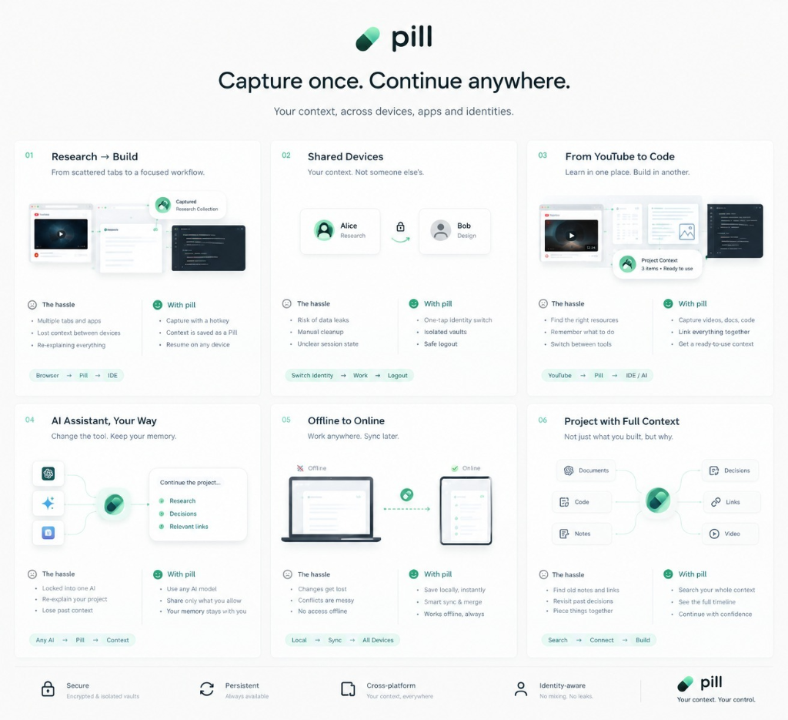
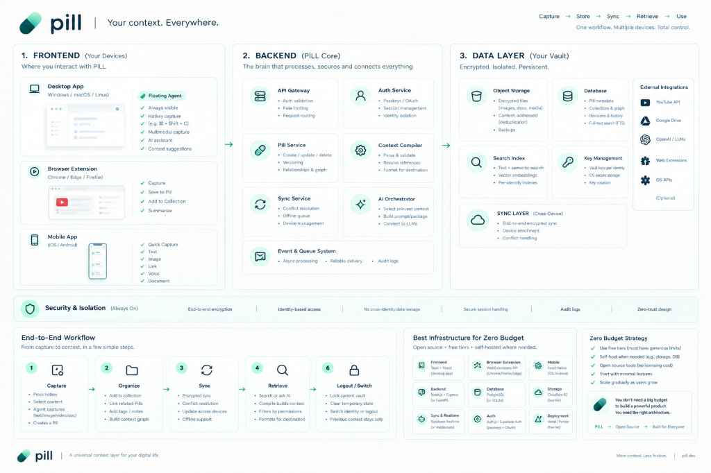

# pill 💊

> **Capture once. Continue anywhere.**  
> *Your context, across devices, apps and identities.*  
> *A universal context layer for your digital life — More context. Less friction.*

---

## 📸 Visual Overview

| Product Workflows | System Architecture & Zero-Budget Stack |
| :---: | :---: |
|  |  |

---

## 🌟 Core Pillars

- **🔒 Secure**: Encrypted & isolated vaults.
- **🔄 Persistent**: Always available across sessions and reboots.
- **📱 Cross-platform**: Your context, everywhere (Desktop, Browser, Mobile).
- **👤 Identity-aware**: No mixing. No leaks.

---

## ⚡ 6 Key Workflows

1. **[01 Research → Build](docs/PRODUCT_WORKFLOWS.md#01-research--build)**: From scattered tabs to a focused workflow (`Browser → Pill → IDE`).
2. **[02 Shared Devices](docs/PRODUCT_WORKFLOWS.md#02-shared-devices)**: Your context. Not someone else's (`Switch Identity → Work → Logout`).
3. **[03 From YouTube to Code](docs/PRODUCT_WORKFLOWS.md#03-from-youtube-to-code)**: Learn in one place. Build in another (`YouTube → Pill → IDE / AI`).
4. **[04 AI Assistant, Your Way](docs/PRODUCT_WORKFLOWS.md#04-ai-assistant-your-way)**: Change the tool. Keep your memory (`Any AI → Pill → Context`).
5. **[05 Offline to Online](docs/PRODUCT_WORKFLOWS.md#05-offline-to-online)**: Work anywhere. Sync later (`Local → Sync → All Devices`).
6. **[06 Project with Full Context](docs/PRODUCT_WORKFLOWS.md#06-project-with-full-context)**: Not just what you built, but why (`Search → Connect → Build`).

---

## 🏗️ High-Level System Architecture

```mermaid
flowchart LR
    subgraph Frontend["1. FRONTEND (Your Devices)"]
        D["Desktop App<br/>(Tauri + React)"]
        B["Browser Extension<br/>(WebExtensions)"]
        M["Mobile App<br/>(React Native)"]
    end

    subgraph Backend["2. BACKEND (PILL Core)"]
        GW["API Gateway"]
        AUTH["Auth Service"]
        PS["Pill Service"]
        CC["Context Compiler"]
        SYNC["Sync Service"]
        AI["AI Orchestrator"]
        EV["Event & Queue System"]
    end

    subgraph DataLayer["3. DATA LAYER (Your Vault)"]
        OBJ["Object Storage<br/>(Cloudflare R2)"]
        DB["Database<br/>(PostgreSQL / SQLite)"]
        IDX["Search Index<br/>(Vector + Full-Text)"]
        KM["Key Management<br/>(OS Secure Storage)"]
        SL["Sync Layer<br/>(E2E Encrypted)"]
    end

    Frontend --> Backend
    Backend --> DataLayer
```

Detailed specifications:
- **[System Architecture Documentation](docs/ARCHITECTURE.md)**
- **[Product Workflows Specification](docs/PRODUCT_WORKFLOWS.md)**
- **[Zero Budget Technology Stack](docs/ZERO_BUDGET_TECH_STACK.md)**
- **[Product Whitepaper](PILL_WHITEPAPER.md)**
- **[Master Build Prompt](PILL_MASTER_BUILD_PROMPT.md)**

---

## 🔁 End-to-End Workflow

1. **Capture**: Press hotkey → Select content → Agent captures (text, image, video, doc) → Creates a Pill.
2. **Organize**: Add to collection → Link related Pills → Add tags & notes → Build context graph.
3. **Sync**: Encrypted sync → Conflict resolution → Update across devices → Full offline support.
4. **Retrieve**: Search or ask AI → Context compiler builds package → Filter by permissions → Format for destination.
5. **Logout / Switch**: Lock current vault → Clear temporary state → Switch identity or safe logout → Context stays isolated.

---

## 💡 Zero-Budget Strategy

> *"You don't need a big budget to build a powerful product. You need the right architecture."*  
> **PILL → Open Source → Built for Everyone**

- **Frontend**: Tauri + React (Desktop)
- **Extension**: WebExtensions API (Chrome / Firefox / Edge)
- **Mobile**: React Native (iOS / Android)
- **Backend**: Node.js + Express (or FastAPI)
- **Database**: PostgreSQL / SQLite
- **Storage**: Cloudflare R2 (generous free tier)
- **Sync & Realtime**: Supabase Realtime / WebSockets
- **Auth**: Auth.js / Supabase Auth (Passkeys + OAuth)
- **Deployment**: Vercel / Render free tiers
