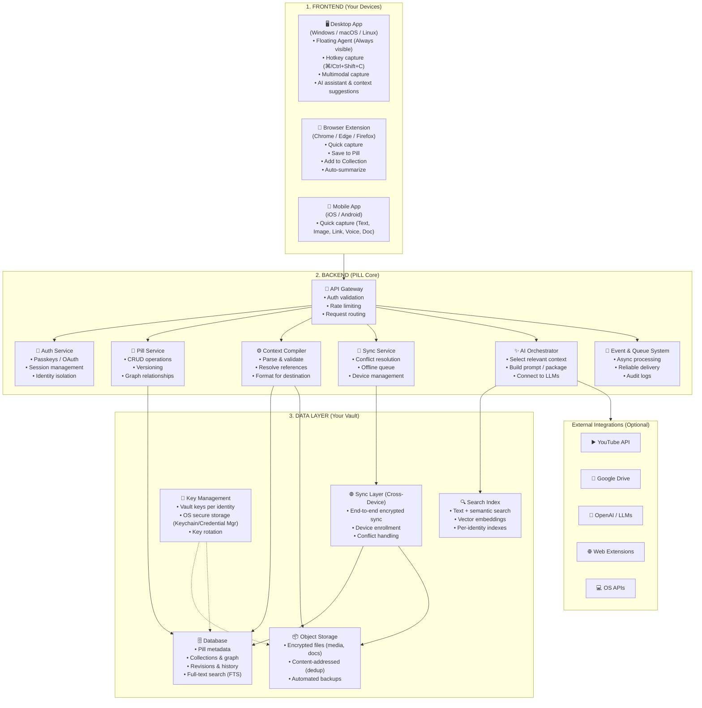

# pill — System Architecture & Workflow Specification

> **pill | Your context. Everywhere.**  
> *One workflow. Multiple devices. Total control.*


---

## Architecture Blueprint



---

## 1. Frontend Layer (Your Devices)

### Desktop App (Windows / macOS / Linux)
- **Engine**: Tauri + React (Lightweight, low memory footprint).
- **Floating Agent**:
  - Always accessible overlay on top of active workspaces.
  - Global hotkey listener (e.g. `⌘ + Shift + C` / `Ctrl + Shift + C`).
  - Multimodal capture: text selections, active window screenshots, file drops.
  - In-situ AI assistant with real-time context suggestions based on current tasks.

### Browser Extension (Chrome / Edge / Firefox)
- **Engine**: WebExtensions Manifest V3.
- **Capabilities**:
  - One-click page, snippet, or media clipping.
  - YouTube player deep-link capture with timestamps.
  - Add to specific collections and tag on the fly.
  - In-browser summarization via lightweight models or backend orchestrator.

### Mobile App (iOS / Android)
- **Engine**: React Native.
- **Capabilities**:
  - System share-sheet integration.
  - Quick capture modes: Text snippets, Camera/Photo images, URLs, Audio/Voice notes, Document files.

---

## 2. Backend Layer (PILL Core)

- **API Gateway**: Handles request routing, token verification, and rate limiting.
- **Auth Service**: Supports passwordless authentication (Passkeys/WebAuthn) and standard OAuth providers. Enforces identity isolation.
- **Pill Service**: Core business domain managing CRUD, pill schemas, graph relationships, and semantic links.
- **Context Compiler**: Aggregates disparate Pills, parses referenced nodes, trims irrelevant data, and formats ready-to-inject prompts for target IDEs or LLMs.
- **Sync Service**: Manages peer device state, offline write queues, and merges using deterministic conflict resolution algorithms (CRDT-inspired).
- **AI Orchestrator**: Dynamically pulls context based on semantic vector similarity, packages instructions, and interfaces with OpenAI, Anthropic, Gemini, or local models.
- **Event & Queue System**: Decoupled asynchronous messaging for indexing, embedding generation, audit logging, and external webhook delivery.

---

## 3. Data Layer (Your Vault)

- **Object Storage**: Content-addressed storage (CAS) for binary assets (images, documents, audio). Deduplicated and encrypted client-side or server-side.
- **Database**: Relational store for metadata, tags, graph edges, version history, and full-text search indexes.
- **Search Index**: Hybrid search combining full-text search (BM25) with vector embeddings (HNSW / cosine similarity) partitioned by identity.
- **Key Management**: Vault-level cryptographic keys tied to user identity. Uses OS hardware security modules (Apple Keychain, Windows DPAPI/Credential Guard, Secret Service API).
- **Sync Layer**: E2E encrypted tunnel ensuring device-to-device synchronization without vendor decryption capability.

---

## 4. Security & Isolation Matrix

```
[ End-to-End Encryption ]  ──────  [ Identity-Based Access ]
[ No Cross-Identity Leakage ] ───  [ Secure Session Handling ]
[ Comprehensive Audit Logs ] ────  [ Zero-Trust Design ]
```

- **Client-Side Key Derivation**: Master keys never leave the client unencrypted.
- **Multi-Tenant Privacy**: Strict partition keys across database records and search indexes.
- **Zero-Trust**: Every payload is verified at the gateway and verified again at the vault layer.

---

## 5. End-to-End Workflow Lifecycle

```
[1. Capture] ──> [2. Organize] ──> [3. Sync] ──> [4. Retrieve] ──> [5. Logout/Switch]
```

1. **Capture**: User triggers shortcut → Agent intercepts active selection → Multimodal ingest → Creates a Pill entity.
2. **Organize**: Automated tagging & manual collection assignment → Edge linking between related Pills → Graph construction.
3. **Sync**: Encrypted payload queued → Sent through sync layer upon connection → Conflict resolution applied → Device mirrors updated.
4. **Retrieve**: User searches via keyword or semantic intent → Context compiler resolves dependencies → Formats tailored context pack for IDE or AI.
5. **Logout / Switch**: Active vault keys purged from RAM → Local temporary state scrubbed → Identity switched cleanly.
